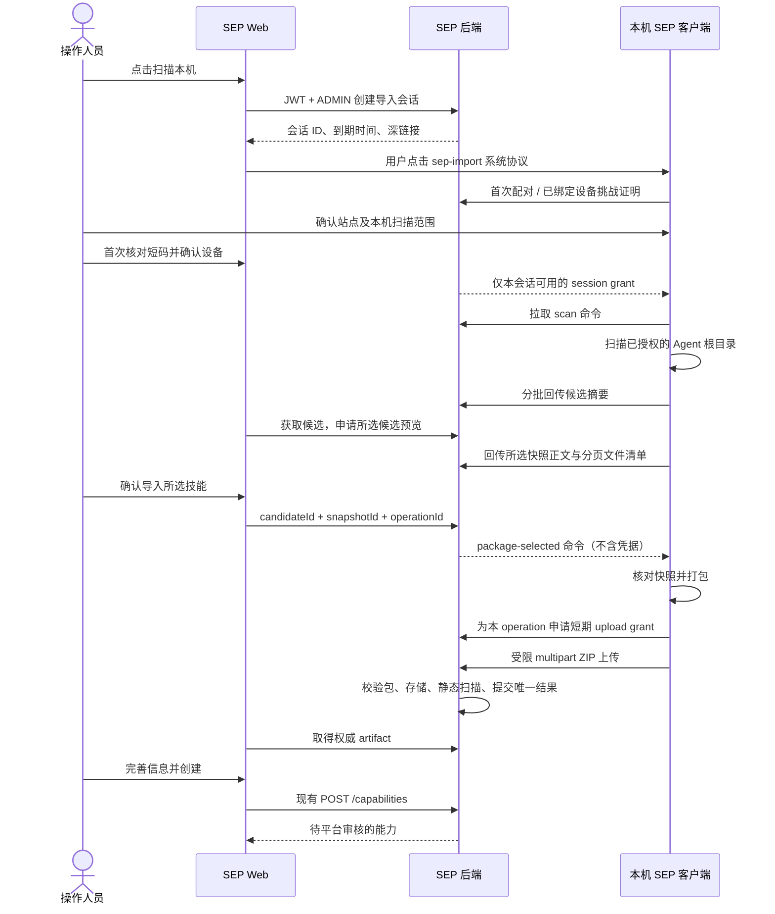

# SEP 本机 Skills 扫描导入全栈开发方案 v1

> 日期：2026-11-03。状态：SEP 后端、Web 与部署配置已实施并完成定向验证；桌面客户端真实实现、签名安装包和生产三端联调仍待完成。本文是 **SEP 侧开发主文档**，覆盖后端、Web、数据、部署和三端联调，不是单独的前端页面方案。当前功能默认关闭，未完成客户端验收前不得启用生产开关。
>
> 用户已确定交付形态：扫描模块内置 SEP 桌面客户端；只安装或升级同一个 SEP 客户端，不另装连接器。本轮已按本文完成 SEP 侧代码与部署改动；没有执行提交、推送或生产部署。

**目标：** 当前 Web `ADMIN` 点击“扫描本机”，唤起同一电脑的 SEP 客户端，发现已授权 Agent 目录中的 Skills，在网页预览、选择后上传完整技能包，继续创建待平台审核的能力。

**架构：** Web 创建云端短期导入会话；桌面客户端负责本机文件访问，通过主动 HTTPS 请求领取命令、回传摘要和上传所选 ZIP。SEP 后端负责身份、设备证明、会话状态、命令事件、限额、权威包校验和结果归属。浏览器始终只访问 SEP API。

**技术栈：** 现有 NestJS、TypeScript、共享 Zod、Prisma/PostgreSQL、Redis/ioredis、SkillPackageService、PackageSecurityService；Web 使用 Next.js、TanStack Query 和现有表单；本机部分使用现有 Electron 客户端。不新增独立 Gateway、扫描服务进程或依赖。

配套详细设计：[Web 前端开发方案](./2026-11-03-Skills本机扫描导入前端开发方案-v1.md)、[客户端开发方案](./2026-11-03-SEP客户端内置Skills扫描开发方案-v1.md)。调研依据：[可行性与代码核查](../research/2026-11-03-本地Agent-Skills扫描上传可行性调研.md)、[连接方式与账号复核](../research/2026-11-03-Web本机Skills扫描与开发者身份方案复核.md)。服务端契约以本文为主，其他两份方案细化各端实现；修改契约时三份同步更新。

**阅读入口：** 两份开发主文档分别是本文（SEP 后端 + Web）和客户端开发方案；原前端方案保留为本文的 UI 细节附件。2026-11-03 已完成两份主文档的纸面联调核对及修订，核对记录与联合验收矩阵见第 13 节；不代表已做真实接口或安装包联调。

**实施记录：** SEP 侧实际文件、验证命令、配置与未完成的真实跨端验收见[开发验收记录](../progress/2026-11-03-本机Skills扫描导入开发验收记录.md)。后续章节保留原设计任务，实际代码将设备/owner/授权/上传编排集中在 `skill-import.service.ts`，Redis、事件、上传拦截器与响应预算分别拆分；不要求为设计中的每个服务名新增空壳文件。

## 1. 开发范围与三端职责

| 部分 | 必须完成的开发 | 单独完成能否交付 |
|---|---|---|
| SEP 后端 | 会话、设备绑定与撤销、挑战证明、受限 grant、命令/事件、分页、上传幂等、包校验、归属与审计 | 不能；需要 Web 发起任务及客户端读文件 |
| SEP Web | 导入入口、协议唤起、设备确认、候选筛选、按需预览、选择、进度、异常与现有创建表单衔接 | 不能；页面没有本机目录访问权 |
| SEP 桌面客户端 | 协议注册、登录前扫描模式、设备密钥、目录发现、授权、快照、打包、受限上传及更新分发 | 不能；需要云端会话协调与平台创建权限 |
| 部署与联调 | HTTPS 实例配置、数据库迁移、Redis、共享包存储、代理预算、签名安装包、三端真实验收 | 是整个功能上线的必要条件 |

首期范围：Windows x64、macOS arm64/x64；单项导入；个人已知目录及本机已授权项目根；现有全局 `ADMIN` 首次创建。保留 ZIP 上传。Linux、WSL、容器、远程目录、全盘查找、批量创建、普通开发者首次投稿另立需求。

“免登录”只针对客户端的扫描模式。Web 必须登录并有权限；设备首次仍需两端确认；未安装客户端的用户需要安装同一个 SEP 客户端。客户端已登录 B、Web 登录 A 时，扫描和创建归属 A，不借用 B 的企业身份。

## 2. 当前代码基线与复用关系

| 代码 | 已有行为 | 本期动作 |
|---|---|---|
| `backend/src/modules/admin/admin-upload.controller.ts` | ADMIN multipart 上传；调用包服务与安全服务，返回既有 artifact 字段 | 保留 ZIP 入口及原 guard；新受限入口复用服务 |
| `backend/src/modules/skill-package/skill-package.service.ts` | 权威 ZIP 校验、SHA-256、解析、内容寻址存储和重读 | 复用；不信任客户端正文、文件数或哈希声明 |
| `backend/src/modules/capability-contribution/package-security.service.ts` | 静态扫描记录、审核/下载门禁；扫描不通过不一定在 `scanSkill()` 内抛错 | 新入口检查返回状态，保留静态扫描限制和警告 |
| `backend/src/modules/capability/capability.controller.ts`、`capability.service.ts` | `POST /capabilities` 首次创建 Skill 仅 ADMIN；重读包核对 metadata，创建待审记录 | 复用创建 DTO、初始版本和审核流程；补充 Skill 创建的活跃 Web 会话检查 |
| `backend/src/modules/capability-contribution/capability-contribution.service.ts` | 禁止通过贡献接口首次创建 Skill | 保持限制；扫描不得改走此路 |
| `backend/src/modules/auth/jwt.strategy.ts` | 校验 access JWT，读当前有效账号及角色，保留 `sid` | 不把 JWT 校验等同于浏览器会话撤销校验 |
| `backend/src/modules/auth/session.service.ts` | 已有 `assertActiveSession(sessionId, userId, clientType)` | 新 Web 接口及客户端代办动作复用 `WEB` 会话检查 |
| `backend/src/redis/redis.service.ts` | 通过注入的 `redis` 提供 ioredis 连接 | 承载短期状态、原子序号、nonce、grant、幂等与限流 |
| `backend/src/common/middleware/json-body.middleware.ts` | 普通 JSON 默认 2 MiB；现有 Skill 分支 16 MiB，不匹配新 events 路径 | 精确增加预览事件路径预算及回归测试 |
| `backend/src/common/filters/http-exception.filter.ts` | 非 Gateway 普通接口默认只保留基础错误信封；本模块新 code 会丢失 | 仅为 skill-import 增加共享错误码白名单序列化与回归测试 |
| `backend/src/common/middleware/basic-rate-limit.middleware.ts` | 当前敏感路径列表不覆盖 `/skill-import`，桶在本进程 | 新模块单独做 Redis 限流及解析前入口保护 |
| `web/src/app/(platform)/admin/capabilities/new/skill-form.tsx` | ZIP 上传、预填、创建表单 | 接入导入工作区，沿用原创建路径 |
| `scripts/skill-scanner/` | 有扫描/打包/CLI 原型，localhost 无生产授权闭环 | 仅作为客户端扫描核心参考，不分发旧桥接服务 |

当前已存在 `backend/src/modules/skill-import/`、共享 schema、设备迁移、Web 导入工作区和部署入口保护。云端会话、设备证明、候选/预览/文件分页、幂等上传及 Web 状态流已完成定向测试；系统协议唤起、真实本机文件扫描和安装包行为仍必须由桌面客户端阶段完成并按 J01–J14 验收。

## 3. 完整工作链路



系统协议只传定位信息：

```text
sep-import://skills/v1?instanceId=<registered-instance-id>&sessionId=<opaque-session-id>
```

它必须精确匹配 scheme/host/path，拒绝重复、未知参数及超过 2 KiB 的 URL。`instanceId` 仅映射客户端受信配置中的 SEP HTTPS 地址；链接不携带 JWT、grant、私钥、绝对路径或任意 `baseUrl`。会话 ID 不能单独换取扫描或上传权限。

协议在用户当前电脑启动程序；服务器不能按“最近在线设备”派发给另一台电脑。异步创建会话后若失去用户激活，Web 展示“打开 SEP 客户端”按钮，由再次点击触发。超时只能表示尚未连接，不能据此断言客户端未安装。

## 4. 后端模块与文件划分

拟新增以下文件；业务逻辑保持在 service，controller 只处理 HTTP、共享 Zod 校验、guard 和 Swagger。

```text
backend/src/shared/
  skill-import-schema.ts
  skill-import-schema.spec.ts
backend/src/modules/skill-import/
  skill-import.module.ts
  skill-import.controller.ts                 # Web JWT + ADMIN API
  skill-import-connector.controller.ts       # 本机模块专用 API
  skill-import.service.ts                    # 用例编排与合法状态迁移
  skill-import-store.service.ts              # Redis 键、TTL、原子操作
  skill-import-device.service.ts             # Prisma 绑定、挑战和证明
  skill-import-owner.service.ts              # 当前角色、WEB sid、归属复核
  skill-import-grant.guard.ts                # session grant
  skill-import-upload.guard.ts               # upload grant + 并发 admission
  skill-import-rate-limit.service.ts
  skill-import-ingress.middleware.ts         # JSON 解析前保护
  skill-import-upload.service.ts             # 包校验、结果提交与重试
  *.spec.ts
  skill-import.http.spec.ts
  skill-import.redis.spec.ts
```

必须修改：`backend/src/app.module.ts` 注册模块；`backend/src/shared/index.ts` 导出 schema；`backend/prisma/schema.prisma` 和工具生成的迁移；`backend/src/main.ts` 在 JSON 解析前装配导入入口保护；`json-body.middleware.ts`、`common/filters/http-exception.filter.ts` 及各自测试；`capability.controller.ts`、`capability.module.ts` 及对应测试，接入 Skill 创建的活跃 Web 会话检查。不要改全站 JWT 策略来顺带重构其他业务。

模块导入现有 `AuthModule`、`PrismaModule`、`RedisModule`、`SkillPackageModule`、`CapabilityContributionModule` 和 `AuditModule`，使用其现有导出。复用包安全服务不代表调用贡献创建接口。新模块无需依赖 `CapabilityModule`，避免为最终创建制造循环依赖。

## 5. 数据与状态设计

### 5.1 PostgreSQL：持久设备绑定

新增 `SkillImportDevice` 模型，与消费端已有 `Device` 分开，避免误继承企业登录权限。

| 字段 | 要求 |
|---|---|
| `id` | `String @id @default(cuid())` |
| `userId` | 当前 Web 用户，关联 `User`，不是客户端登录用户 |
| `instanceId` | 部署实例稳定 ID |
| `publicKey`、`keyFingerprint` | 限长的 Ed25519 公钥及其规范编码 SHA-256 指纹 |
| `label`、`platform`、`clientVersion` | 显示元数据，长度受 schema 限制，不作为身份凭据 |
| `scopeSummary` | 已确认范围摘要，不保存本机绝对路径 |
| `lastSeenAt`、`revokedAt` | 最近活动及撤销状态；每个请求不能高频更新数据库 |
| `createdAt`、`updatedAt` | 标准时间字段 |

唯一约束 `(instanceId, userId, keyFingerprint)`；索引 `(userId, revokedAt)`；`@@map("skill_import_devices")`。撤销保留审计信息；重新绑定必须重新明确确认，不能因唯一键存在而自动恢复。不得存私钥、客户端业务 refresh token 或通用 ADMIN token。

模型通过 Prisma 工具生成迁移，开发阶段顺序为 `pnpm db:migrate` → `pnpm db:generate`，生产执行既有发布流程的 migration deploy。本文不提供手写历史迁移，也不在文档工作中运行迁移。

### 5.2 Redis：短期会话与结果

统一前缀 `skill-import:v1:<instanceId>:`。每个值有版本与明确到期时间；使用现有连接，禁止只放 Node 内存。

| 数据 | 最少字段/约束 |
|---|---|
| session | ownerUserId、ownerWebSessionId、deviceId/pairingId、status、version、epoch、创建/空闲/绝对截止时间 |
| pairing/challenge | 公钥指纹、一次性 nonce、双方确认、会话/实例绑定、5 分钟内到期 |
| grant | 仅保存随机高熵 token 的 hash；绑定类型、会话、设备、epoch、到期及用途 |
| commands | 单会话单调 sequence、commandId、类型、不含 grant 的受限 payload、截止时间 |
| events | eventId 去重、命令关联、批次及接收序号，不无限保存原始事件流 |
| candidates | 分批候选摘要；最多 5,000 条，分页索引、revision 与扫描轮次 |
| preview | 当前所选 snapshot、正文、分页文件信息与哈希；替换选择时及时回收旧正文 |
| operation | operationId、candidateId、snapshotId、请求摘要、状态、已接收 ZIP sha256、结果或受控错误 |

单会话只保留当前选择的正文/快照，其他候选只存摘要；所有数组、字符串及分页字节数有上限。JSON 16 MiB 是传输预算，不意味着把任意大响应直接常驻 Redis。附件二进制不进入 Redis。

Redis 故障时返回 503，禁止降级为无状态放行。Redis 数据丢失时旧会话与 grant 失效，用户重新发起；不承诺导入会话跨 Redis 全量丢失恢复。后端进程重启或多个副本间请求切换应继续依赖 Redis 工作，不依赖 sticky session。

### 5.3 状态机、原子操作与时限

```text
waiting-client → pairing（首次绑定）→ ready → scanning → results
results → previewing → results
results → packaging → uploading → uploaded
任意非终态 → cancelled / expired / failed
```

已绑定设备完成本次密钥证明和本机同意后可从 `waiting-client` 进入 `ready`；同一原子操作仅入队一条初始 scan 命令，客户端回传 command-started 后才进入 scanning。grant 续期、重复唤起和重复拉取不得再入队扫描。`uploaded` 只表示包导入成功；能力创建与审核是现有业务后续步骤。Web 的“刷新扫描”先取消旧会话，再创建新会话并明确唤起；首期不提供同会话 rescan，旧候选、快照与 selection 不得跨会话使用。

- 等待领取/配对 5 分钟；会话空闲 10 分钟；会话和任务绝对上限 30 分钟。
- upload grant 在 ZIP 已生成后申请，最长 5 分钟且不超过会话剩余时间；session grant 最长 10 分钟且不超过绝对截止时间，提前 60 秒走新挑战证明续期。上传授权过期按第 8.2 节恢复，不能靠重放旧命令领新 token。
- 心跳、只读轮询、grant 续期不延长空闲时间；合法用户操作、实际进度增加或成功提交的新数据可更新空闲时间，绝对截止时间不延长。
- 轮询起始 2 秒，故障退避最高 10 秒并加抖动，遵守 `Retry-After`；终态停止。
- Lua/事务比较 session version/epoch，完成认领、确认、selection、nonce 消费、命令序号和事件去重。外部文件 I/O 不放 Redis 脚本中。
- 取消先原子设置终态并增加 epoch，吊销授权；cancel 命令仅为已在途响应的辅助提示，不依赖失效 grant 再取命令。客户端命令轮询收到 410/SESSION_CANCELLED 或授权被撤销时立即停止；断网时最晚在本地 grant/会话截止时间停止读取、上传和轮询。上传或扫描完成后再次比较 epoch，迟到结果不能覆盖取消。
- TTL 回收只是物理清理；每次操作都验证截止时间，不依赖 Redis 删除通知保证业务正确性。

## 6. 身份、配对与权限

### 6.1 Web 发起者检查

新 Web controller 使用 `JwtAuthGuard`、`RolesGuard`、`@Roles(UserRole.ADMIN)`；owner service 进一步检查：

1. 当前账号仍有效、仍是全局 ADMIN，不能只用会话创建时缓存的角色。
2. `req.user.sid` 存在且 `SessionService.assertActiveSession(sid, userId, 'WEB')` 通过。
3. session.ownerUserId 与当前用户相同，session.ownerWebSessionId 与当前发起浏览器登录会话相同。另一个浏览器登录即使是同一账号，也不能接管未结束任务。
4. 会话未过期/取消，设备未撤销，所请求的候选、快照及 operation 属于该会话。

客户端拉命令、回事件、上传、提交结果也通过服务端记录的 ownerUserId/ownerWebSessionId 复核当前授权，不能只检查 grant 的签名或到期时间。退出登录的取消通知可能丢失；后端靠已有 auth_sessions 状态拒绝后续动作。已在本机运行的读取由客户端在下次请求失败/取消后停止，不能声称网页退出瞬间能远程中断每一次本机系统调用。

最终 `POST /capabilities` 对 Skill 创建同样补充有效 `WEB sid` 检查，现有 service 的 ADMIN 检查继续保留。不要通过修改通用 JWT 逻辑扩大到所有业务。

### 6.2 首次设备绑定

1. 客户端生成 Ed25519 密钥对，发送公钥、版本和 session ID；服务端只创建待确认 pairing，不发扫描授权。
2. 服务端生成 nonce、5 分钟挑战与匹配短码。Web 展示待确认设备、指纹和短码；客户端从已受信实例获取站点、发起者及相同短码。
3. 用户在客户端确认站点和扫描范围，在 Web 确认具体 pairingId/指纹/短码。客户端签名证明持有私钥，服务端校验并一次性消费 nonce。
4. 两端同意和证明均成立后，才能生成设备绑定与 session grant。并发 claimant 不得覆盖已选 pairing；每会话最多 3 个待确认 claimant，超出限流。

短码用于人工核对，不作为独立 bearer secret；单有 session ID 或短码不能领任务。签名、等待与响应丢失语义统一如下，客户端不得各自猜测：

- `POST grants` 在签名有效但 Web 未确认时返回 202 `{status:'pending-web-confirmation',pairingId,retryAfterSeconds:2,expiresAt}`，不签发 grant、不消费 nonce；客户端按 2 秒有界轮询同一个请求，最多到本次配对截止时间。
- 双方已确认后原子消费 nonce 并返回 200，包含 `sessionId/deviceId`（临时配对时 deviceId 为 null）、`sessionGrant/sessionGrantExpiresAt/sessionExpiresAt/idleExpiresAt/acceptedScopeHash`；扫描授权前先核对范围 hash。
- 已消费挑战再次换 token 返回 409 `CHALLENGE_USED`，不再次发送旧 token。200 响应丢失时通过 challenges 获取新 nonce、重新证明再换 session grant；同一 pairing 的双方确认在本会话剩余有效期内复用，不让用户重做配对。
- 续期只替换本会话 session grant，不重置截止时间、不重新扫描、不扩大范围；已有独立 upload grant 按其自身有效期处理。续期/响应丢失恢复后客户端用服务端 cursor/operation 状态恢复，不重执行命令。

使用 Node 标准 crypto 的 Ed25519，公钥为 SPKI DER 的无填充 base64url，指纹为其 DER 字节的 SHA-256 小写十六进制，签名亦为无填充 base64url。挑战返回 `challengeId/purpose/instanceId/sessionId/pairingId/deviceId/keyFingerprint/nonce/expiresAt`，所有值为服务端权威字段；purpose 为 `session-grant` 或 `device-revoke`。签名字节精确为下列有序数组经 `JSON.stringify` 后的 UTF-8，不附换行：

```ts
JSON.stringify([
  'SEP-SKILL-IMPORT', 1, purpose, instanceId, sessionId ?? null,
  pairingId ?? null, deviceId ?? null, keyFingerprint, challengeId,
  nonce, expiresAt, consentHash,
]);
```

`consentHash` 为 UTF-8 `JSON.stringify([rememberDevice, scope, [...rootIds].sort()])` 的 SHA-256 小写十六进制；rootIds 去重后排序且仅为本机不透明 ID，scope 为 `user/project/all`，不含绝对路径。`device-revoke` 使用固定 consent `[false,'revoke',[]]`，sessionId/pairingId 为 null。schema 与两端 fixture 固定 ISO UTC 毫秒时间字符串和每个编码，提供有效签名/改字段失败的用例；不自行实现密码学算法。

后续同一站点/发起用户/系统用户/范围，收到本次深链接后前台展示上下文，可按已存授权自动生成本次 consent，不重复两端短码确认；新增根、范围扩大、身份变化或设备撤销后重新两端确认。需要扩展范围时取消旧会话，创建新会话，不在已批准任务里悄悄换 rootIds。

客户端私钥由 safeStorage 保护，留在主进程，不进入 Web、IPC、日志或 URL。安全存储不可用时仅提供本次内存密钥配对，不记住设备，不明文落盘；本机 consent 明确 `rememberDevice:false`，服务端只把该公钥绑定到本次 pairing/session，不创建可复用设备绑定。已有绑定仍需本次 challenge；设备密钥不是管理员账号。

### 6.3 两类 grant

返回的 `acceptedScopeHash` 精确定义为 UTF-8 `JSON.stringify([scope,[...rootIds].sort()])` 的 SHA-256 小写十六进制；rootIds 先去重再排序，scope 为 user/project/all。它不含 rememberDevice，和签名使用的 consentHash 区分。客户端 IPC 提交本机已回显的 scope/rootIds，主进程再次核准，不能仅提交 pairingId/rememberDevice 后自行扩大签名范围。

| 授权 | 能力 | 禁止 |
|---|---|---|
| session grant | 本会话命令、事件、操作状态、申请限定上传授权、取消 | 列举其他用户任务、任意文件读取、创建能力、调用 ADMIN 上传 |
| upload grant | 本次 session/candidate/snapshot/operation 的单包上传及同内容安全重试 | 上传其他快照、换包覆盖、调用通用管理接口 |

grant 在 `Authorization: Bearer` 中发送；服务端按独立用途 guard 解析，不当作业务 JWT。两类 grant 都只由对应签发 API 返回给客户端主进程，Web、命令/事件队列、审计日志不包含 token。服务端仅保存 token hash；签发响应丢失时重新鉴权换发，不从 hash 恢复旧 token。客户端得到的会话信息仅限当前任务必要字段。

## 7. API 与共享契约

所有路径相对 `/api`，协议版本固定为 `1`。请求、响应及分页 query 使用共享 Zod 运行时 schema；未知字段拒绝，ID/字符串/数组有上限。每个接口补 `ApiTags`、`ApiOperation`、成功及错误 `ApiResponse`；设备 bearer 授权与业务 JWT 在 Swagger 中分别声明。

### 7.1 Web API

| 方法与路径 | 请求/响应与规则 |
|---|---|
| `GET /skill-import/config` | 当前 ADMIN + 活跃 WEB sid；返回 `{enabled,instanceId,protocolVersion:1,minClientVersion}`，关闭功能时仍可读取，Web 据此控制入口。不是客户端实例发现接口 |
| `POST /skill-import/sessions` | `{requestId,protocolVersion:1,scope:'user'|'project'|'all'}`，默认 user；返回 id、status、instanceId、expiresAt、protocolVersion、deepLink。requestId 在 owner WEB sid 内幂等，项目范围只使用本机已授权根 |
| `GET /skill-import/sessions/:id` | 使用下述 view 分页；不返回完整命令、grant 或未选择正文 |
| `POST /skill-import/sessions/:id/confirm-device` | `{pairingId,keyFingerprint,shortCode}`；确认匹配 claimant，幂等 |
| `POST /skill-import/sessions/:id/preview` | `{requestId,candidateId,revision}`；202 返回 requestId/commandId，Web 继续轮询预览；相同 requestId 同内容幂等，仅接受当前会话候选 |
| `POST /skill-import/sessions/:id/selection` | `{candidateId,snapshotId,operationId}`；202 返回 operation 状态，相同 operation 同 payload 幂等，不同 payload 409 |
| `DELETE /skill-import/sessions/:id` | 非终态幂等转 cancelled；uploaded 后只关闭会话并吊销 grant，保留 uploaded 历史，不改为 cancelled；已存包按既有生命周期管理 |
| `GET /skill-import/devices` | 当前用户/实例未撤销绑定，`limit` 默认 25、最多 100，`cursor` 为服务端上一页返回值；响应 `{items,nextCursor}`。按创建时间与 ID 稳定分页，不是本机安装检测 |
| `DELETE /skill-import/devices/:deviceId` | 仅本人绑定；落库撤销后，所有后续 grant 使用均失败，尽力取消关联会话 |

`GET session` 的 `view` 为区分联合，不把大对象混入默认轮询：

| view | query | 内容 |
|---|---|---|
| `status`（默认） | 无 | 状态、version、截止时间、设备确认摘要、进度、计数、operation 简述 |
| `candidates` | cursor、limit≤25、q、source、scope | 候选摘要页及 nextCursor；扫描追加不得造成静默漏页 |
| `preview` | candidateId、requestId | 当前所选预览，正文最多一份；未就绪返回明确 pending；旧 requestId 返回已被替代 |
| `files` | snapshotId、cursor、limit≤100 | 该快照相对文件清单页 |
| `operation` | operationId | pending/processing/succeeded/failed 与已知结果；未知结果重试前查询 |

cursor 必须绑定 session、轮次和筛选条件，拒绝跨范围使用；不能把任意 Redis key 暴露为游标。候选页按稳定 sequence 排序。uploaded 后默认状态只给 artifactReady，Web 显式取 operation 结果，避免每 2 秒重复传正文。

快速切换候选时 preview 请求采用最新 requestId，替换旧请求与快照；旧 command 的迟到预览被 ack 为 ignored，不覆盖新预览，也不导致事件序号断档。服务端仅在完整预览及全部文件页已接收时标记 ready，Web 才能提交 selection。预览超过 60 秒返回本次预览错误并回 results，不自动把整个会话置 failed；CANDIDATE_CHANGED/SNAPSHOT_EXPIRED 同样回 results 并使旧快照失效，可重新预览。

替换或超时的 preview 命令立即退出待领取队列，避免废弃命令占满 20 条领取窗口；已完成命令的迟到事件只 ack 为 ignored，不回退后续阶段。文件分页与状态轮询分别限流；文件请求临时失败遵守 Retry-After，自动重试至多两次，仍失败时允许手动继续失败页。

### 7.2 客户端内置模块 API

两种 operation 查询共用 `status:'pending'|'processing'|'succeeded'|'failed'` 与 `retryable:boolean`。pending 可继续，processing 等待，failed 仅 retryable=true 可同包重试，succeeded 不再申请上传授权；retryable 不是第五种状态。Web 额外返回 artifact，客户端仅接收本节的安全摘要。

`connector` 是技术命名空间，不是独立软件安装物。

| 方法与路径 | 凭据/行为 |
|---|---|
| `POST /skill-import/connector/pairings` | requestId、sessionId、公钥、协议/客户端版本、设备元数据；同请求幂等创建 pairing，返回 pairingId、短码、发起者显示标签、请求范围与挑战，不发扫描授权 |
| `POST /skill-import/connector/challenges` | purpose=session-grant 时 sessionId + deviceId 或 pairingId，客户端同时发送当前 clientVersion（正式 x.y.z）；purpose=device-revoke 时仅 deviceId，无 session/clientVersion。请求新一次性挑战，只返回任务确认必需信息 |
| `POST /skill-import/connector/grants` | challengeId、签名和本机同意（rememberDevice/scope/rootIds）；按 6.2 节返回 202 等待或 200 session grant |
| `GET /skill-import/connector/sessions/:id/commands?cursor=...` | session grant；固定命令页及 nextCursor，2 秒轮询，不提供跨会话列表 |
| `POST /skill-import/connector/sessions/:id/events` | session grant；候选批次、preview、文件批次、进度、command-completed、受控错误；响应 ack cursor |
| `GET /skill-import/connector/sessions/:id/operations/:operationId` | session grant；返回 operation 状态、retryable、sha256（已确定时）、错误码和截止时间；不返回正文/artifact/grant |
| `POST /skill-import/connector/sessions/:id/operations/:operationId/upload-grant` | session grant；ZIP 已完成后提交 candidateId/snapshotId/packageSha256/packageBytes；匹配 selection 与预算后签发 uploadGrant/expiresAt；只 hash 存储，新授权替换旧授权 |
| `POST /skill-import/connector/sessions/:id/package` | upload grant；multipart 单个 `file`，operation/snapshot 元数据必须匹配 grant |
| `DELETE /skill-import/connector/sessions/:id` | session grant；通知本机取消，客户端不等待通知成功才停止本地操作 |
| `POST /skill-import/connector/devices/:deviceId/revoke` | purpose=device-revoke 的挑战签名；只撤销该公钥对应绑定并取消任务，不需要已有效 session grant，不能操作其他绑定 |

固定命令仅 `scan`、`preview`、`package-selected`、`cancel`，共有 `sessionId/commandId/sequence/expiresAt/type/payload`。payload 不接受任意路径、URL、shell、代码或可调用方法。scope/rootId 仅引用客户端已授权范围。

会话挑战和 grant 签发均校验当前最低客户端版本，记住设备也不豁免。共享 schema 暂保留可选 clientVersion 以兼容已创建的 pairing；缺省时使用该 pairing/设备记录版本，仍执行最低版本校验。客户端升级后发送当前版本，不能依赖绑定时保存的旧版本。版本字段不加入挑战响应或更改现有签名数组。

scan payload 为本会话 scope/获准 rootIds；preview 为 requestId/candidateId/revision；package-selected 为 candidateId/snapshotId/operationId，**不含 upload grant**。打包后才申请授权，避免打包耗时消耗上传时限。命令读取是至少一次投递，只有 command-started/完成事件确认后推进服务端 ack；客户端不得仅因收到 nextCursor 就丢弃未执行命令，设备内按 commandId 去重。

事件共有 `eventId/commandId/sequence/type/payload`；服务端校验命令关联及允许的事件类型。重复 eventId 相同内容返回原 ack，改内容 409；批次按稳定 ID 去重，顺序间断要求补齐，不把漏批结果当完整扫描。网络失败可重发，不能使候选数或进度重复累加。客户端事件不能自行设为 uploaded、提交 zipPath 或绕过服务端包接收步骤。

### 7.3 核心数据结构

```ts
interface SkillImportCandidate {
  candidateId: string;
  revision: number;
  name: string;
  description: string | null;
  sources: string[];
  scope: 'user' | 'project';
  locations: Array<{ rootId: string; rootLabel: string; relativePath: string }>;
  treeHash: string | null;
  availability: 'previewable' | 'blocked';
  warnings: Array<{ code: string; message: string; severity: 'warning' | 'blocking' }>;
}

interface SkillImportSelection {
  candidateId: string;
  snapshotId: string;
  operationId: string;
}
```

preview 字段统一为 `requestId/candidateId/snapshotId/expiresAt/content/treeHash/fileCount/totalUncompressedBytes/estimatedPackageBytes/files/nextFilesCursor/warnings`；`files` 为首批相对清单数组，`nextFilesCursor:string|null` 定位后续 files view。后续页固定 `{snapshotId,files,nextFilesCursor}`。snapshotId 不是 token。`treeHash` 表示本机候选内容树，服务端 ZIP `sha256` 表示实际 ZIP 字节，二者不能混用。

selection 请求示例（仅字段示例，ID 为占位值）：

```json
{
  "candidateId": "candidate-example",
  "snapshotId": "snapshot-example",
  "operationId": "operation-example"
}
```

### 7.4 限额与错误

| 对象 | 上限 |
|---|---|
| `SKILL.md` UTF-8 原文 | 2 MiB |
| ZIP 文件 | 100 MiB |
| 解包总量/条目 | 500 MiB / 10,000 |
| 候选/文件页 | 25 / 100 项，且序列化后≤1 MiB |
| 纯摘要事件/响应 | 1 MiB，超出拆批 |
| 含单份入口正文的 preview event/response、artifact response | 序列化后≤16 MiB，原文仍≤2 MiB |
| 会话内候选数 | 5,000，超出明确截断 |
| 本机任务 | 每客户端进程最多一个扫描/打包任务 |

现有 shared `skill-content-schema.ts` 继续提供包预算常量。响应、事件均在两端校验序列化预算；不能只校验字符串长度，也不能累计多份正文后一次返回。

新错误使用 Nest HTTP exceptions 和现有过滤器；可在 exception body 中提供稳定 `code`，集成测试确认最终信封兼容。至少定义 `DEVICE_CONFIRMATION_REQUIRED`、`CHALLENGE_USED`、`GRANT_EXPIRED`、`CLIENT_UPGRADE_REQUIRED`、`SESSION_EXPIRED`、`SESSION_CANCELLED`、`DEVICE_REVOKED`、`CANDIDATE_CHANGED`、`SNAPSHOT_EXPIRED`、`OPERATION_CONFLICT`、`PACKAGE_REJECTED`、`IMPORT_UNAVAILABLE`。400 参数错误；401 凭据/grant 失效；403 权限/授权不足；404 隐藏他人资源；409 状态冲突；410 本人会话过期/取消；413 超预算；429 限流；503 基础设施不可用。客户端 401 仅在 GRANT_EXPIRED 且原会话仍有效时尝试一次挑战续期；其他撤销/失效立即停止，不循环续期。

现有 `HttpExceptionFilter` 会丢弃普通业务路由新增的顶层 code，因此必须为精确 `/api/skill-import(?:/|$)` 路由增加共享错误码白名单处理；只输出既有 `statusCode/message/requestId/timestamp/path` 及通过 schema 的 code/可选 retryable，不透传任意异常对象。413 的 REQUEST_BODY_TOO_LARGE 同样保留。其他路径原错误信封不变。客户端解析顶层 code；Web 从既有 `ApiError.body` 解析，不靠中文 message 分支。真实 HTTP 测试覆盖过滤器，而非仅断言 service 抛出了含 code 的 exception。

## 8. 上传接收与现有能力创建

### 8.1 接收顺序

1. upload guard 在 multipart 解析前从 token 记录取出 operation/snapshot/packageSha256/packageBytes，校验 token hash、会话 owner、当前 WEB sid/ADMIN、设备撤销、epoch 与时限，并取得有界并发槽；不能依赖此时尚未解析的 multipart fields 完成授权。
2. 使用单文件 multipart 和既有 `SKILL_PACKAGE_MAX_BYTES`；限制字段数、字段长度及附加 part。文件上限 100 MiB 不等于整个 multipart body 上限。
3. 对实际文件字节先核算 SHA-256 与大小，必须匹配 grant 绑定的 packageSha256/packageBytes，再调用 `SkillPackageService.store(file)` 得到权威包内容/统计；不接受客户端指定 zipPath。multipart 如带 operation/snapshot 字段仅复核一致，不用于建立权限。
4. 调用 `PackageSecurityService.scanSkill(stored)` 并检查返回 status；新导入入口只有 `PASSED` 才提交可导入 artifact。FAILED/QUARANTINED 等返回受控阻断；保留 `STATIC_ONLY_SCAN` 及服务端扫描警告，不宣传病毒库或沙箱验证。
5. 完成外部 I/O 后重新检查 owner 授权、设备、截止时间及 session epoch；通过 Redis 原子操作提交唯一 operation 结果并转 uploaded。取消或撤销已生效时不发布成功结果。
6. 成功/失败/断连均释放 admission；释放失败由租约回收。有并发占用、包存储或扫描失败时不得返回伪成功。

现有包服务需要 `file.buffer`，本期服务端仍有有界整包内存开销，不能写成已经实现后端全程流式处理。客户端按其方案流式读取/打包。后端初始部署全局导入上传并发槽为 1，配合 ingress 在分配 multipart buffer 前拒绝超额请求；基于实测内存峰值再调整。租约有 owner/fencing 标识和有界续租，进程退出能回收；部署内存必须包含 ZIP 解析/解压与现有业务余量。

### 8.2 operation 幂等与未知结果

- selection 首次原子记录 `(sessionId, operationId, candidateId, snapshotId)`；同键同请求返回原状态，同键换快照返回 409。
- 客户端收到命令只执行一次；上传重试复用同一个确定 ZIP，不从变化的目录重新打包。
- 打包完成后首次申请 upload-grant 即锁定 operation 的 packageSha256/packageBytes；实际上传由服务端重算匹配。之后同 operation 换哈希/大小必须拒绝；grant 不允许覆盖其他快照或结果。
- 并发相同 operation 只有一个 processing lease；其余返回处理中及 Retry-After。临界处重查 lease/epoch，旧 worker 不得发布结果。
- 已成功且授权仍有效的同内容重试返回同一个结果；网络中断先用客户端 GET operations/:operationId 查询。succeeded 直接完成；processing 等待；pending/retryable 才用原 ZIP 重新申请 upload-grant 并传包；失败不可重试时停止。Web 仍使用自己的 operation view。
- 响应丢失不等于存储失败。进程在 store 与结果提交之间崩溃，恢复后可用同 ZIP 重试，内容寻址避免生成第二份不同包，Redis 幂等保证只有一个可见结果。Redis 丢失则旧会话失效，重新导入。
- session grant 过期但会话仍有效时走 challenges/grants 新证明；upload grant 通过 operations/:operationId/upload-grant 换发，不换 operation/snapshot/ZIP。新授权不撤销已获准执行的 processing lease，但不得并发启动第二次上传。旧 upload grant 仅禁止发起新的请求；已在期限内开始的接收/校验可继续到 uploadStartedAt + 5 分钟且不超过会话截止时间，结束前复核 owner/epoch/设备及处理截止时间。会话过期后必须新建。

### 8.3 artifact 与创建

权威 artifact 保持现有字段：`zipPath/sha256/fileCount/totalSize/filename/content/suggested/warnings`。`totalSize` 是解包内容总量，不是 ZIP 传输字节。filename 必须经过现有清洗；警告合并时避免重复。

Web 只从本人会话取回 artifact，再填现有表单并调用 `POST /capabilities`。contributorId 始终取服务端当前请求用户；服务器重读包核对正文与 metadata，创建待审核 Skill 和初始版本。不得直接发布，也不调用客户端企业能力安装接口。

本期“归属”指会话/导入结果访问控制和最终创建者。现有内容寻址包服务不是按用户隔离的私有文件系统，metadata 本身不是 owner 凭证；本文不假称既有包存储已经实现逐用户所有权，也不顺带改造全站存储权限。

上传幂等不等于创建幂等。现有 `POST /capabilities` 未证实支持业务幂等键；Web 创建 `retry:false`，结果未知时去能力列表核对，不自动重复提交。明确失败可保留已取回 artifact 与表单修正后再提交；会话过期前未取回结果须重新导入。取消/失败后不可随意删除内容寻址包，可能被其他能力引用；沿用存储生命周期并在实施时核对回收机制。

## 9. 限流、请求预算、审计和部署

### 9.1 解析前保护与业务限流

`main.ts` 中新 ingress middleware 在 `createJsonBodyMiddleware()` 前执行，仅匹配 `/api/skill-import`。对匿名 pairing/challenge/grant 先做可信代理解析后的 IP 频率限制；鉴权后再做用户/设备/session 粒度限制。不要仅在 controller 执行完大 JSON 解析后才限流。

建议初始配置：每用户最多 3 个活动会话，创建 5 次/分钟；新 pairing/challenge 每 IP 20 次/分钟、每 session 5 次/分钟；同 pairing 的 grants 确认轮询单独 40 次/分钟，不能复用新 pairing 的低频桶；设备命令读取 60 次/分钟；Web 状态 60 次/分钟；operation 查询 60 次/分钟；事件 120 次/分钟且单会话累计事件 JSON 最多 128 MiB（重传亦计入入口流量预算）；preview/selection 20 次/分钟；上传授权申请及上传启动每 operation 各 5 次/5 分钟。各桶分别计数，Redis 原子消费，429 返回 Retry-After；取消/撤销保留独立预算避免被轮询耗尽。部署按 NAT 和实际并发测试调整，不能把业务身份直接信任为请求自报值。

Web 的 status/candidates/preview/operation 视图按用户、会话和 view 各自 60 次/分钟；files 独立 120 次/分钟，允许一次完整读取 10,000 文件（100 页）。事件累计预算使用 JSON parser 实际接收并解压后的 buffer 字节，包含转义、重传、语法错误与 DTO/状态校验失败，独立 Redis 原子计数，固定 35 分钟 TTL，不随业务状态回滚；超过单请求限制的请求仍由入口/parser 拒绝。

在 `json-body.middleware.ts` 仅为 `POST /api/skill-import/connector/sessions/:id/events` 添加现有 16 MiB Skill parser 分支；共享 Zod 再按 event type 区分 1 MiB 摘要和 16 MiB 单正文事件。其他导入 JSON 保持普通预算。测试转义后的 2 MiB Markdown 可以进入事件路由，超过事件预算被拒绝，其他普通路由仍为原限额。

HTTPS 代理为该 events 路径配置匹配 JSON 预算；package 路径 body 上限建议 101 MiB，并在应用层限制 metadata/part，验证 multipart 开销可容纳；网络/代理上传超时不超过业务会话时限，不能只改浏览器超时。正式代理配置和带宽尚未按此功能验证，实施时需真实验收。

### 9.2 配置与可观测性

拟新增配置项纳入现有配置校验：`SKILL_IMPORT_ENABLED`（默认 false）、`SKILL_IMPORT_INSTANCE_ID`、`SKILL_IMPORT_MIN_CLIENT_VERSION`、`SKILL_IMPORT_UPLOAD_CONCURRENCY`（初始 1）。Web 开关与后端一致，后端关闭后拒绝新任务并停止发放新授权，不凭 Web 隐藏入口当访问控制。客户端受信实例配置同步稳定 instanceId 与 HTTPS endpoint；不复用用户可任意输入的 URL。

复用 AuditService 新增会话创建、设备确认/撤销、选择、上传完成/阻断的审计事件；能力创建者、提交时间和待审状态仍由现有能力记录保存。只写 actor、资源 ID、状态、受控原因、数量/耗时和必要指纹；不写 token、nonce、正文、密钥、绝对路径和文件原文。不得从 ZIP 全文构造日志。审计故障转换为 Nest 503，不暴露原始数据库异常；取消/撤销先执行安全收敛，不能因审计失败保留授权，错误可重试并单独告警。

指标至少覆盖会话成功率、配对等待、扫描耗时、上传耗时、拒绝码、并发占用和 Redis/存储错误；设备 lastSeen 降频更新。候选/正文短期数据按会话 TTL 清理，审计按现有保留策略，不能把包含正文的事件历史永久归档。

### 9.3 多副本与发布顺序

Redis 共享不足以保证包可读：现有包服务可能写本地目录，多副本部署必须使用现有受支持的共享存储或共同挂载，保证上传副本、创建副本、下载副本读取同一个内容寻址包。不能依赖请求碰巧落同一实例。

发布顺序：数据库兼容迁移 → 后端默认关闭部署 → 正式签名客户端安装/升级与系统协议验收 → 三端联调 → 小范围开放 Web/后端开关。客户端最低版本使用真正包含扫描功能的发布版本，不能把当前下载配置的旧版本当已支持。

回滚优先关闭新会话/新授权与 Web 入口，取消运行中导入并让客户端停止；保留 ZIP 上传、已创建能力和审核记录，不删除用户本机文件。设备表新增迁移不因入口回滚立刻删除。生产发布另按项目授权执行。

## 10. Web 与客户端实施边界

Web 具体文件、布局、状态和测试见[前端方案](./2026-11-03-Skills本机扫描导入前端开发方案-v1.md)。核心要求是 TanStack Query 请求/轮询，Zustand 只保存 UI 状态，内存 access token 和现有 refresh 链路不变；不把设备密钥/grant 放到浏览器。`SkillForm` 继续管理创建 DTO，导入工作区仅产生 artifact。

客户端具体文件、IPC、深链接生命周期、路径表、快照和安装包见[客户端方案](./2026-11-03-SEP客户端内置Skills扫描开发方案-v1.md)。扫描模块需在企业登录前可用，不能借用 `withAuth` 或因消费端登录/退出永久销毁；本机读取、秘密阻断和一致快照必须先于上传。Web 只认识 rootId 和相对路径；自定义项目目录首次仍由本机用户选择授权。

## 11. 分阶段开发任务

下列任务保留原设计的实施顺序与验证要求。SEP 侧当前已完成的实际验证见开发验收记录；客户端任务及真实跨端验收仍未完成。文件路径相对 SEP 仓库，客户端路径见配套文档，不自动提交。

### Task 1：冻结三端契约与 fixture

**文件：** 新建 `backend/src/shared/skill-import-schema.ts`、`skill-import-schema.spec.ts`；修改 `backend/src/shared/index.ts`。Web 新建 `web/src/features/skill-import/import-contracts.ts`，客户端同步其共享 schema/fixture。

1. 编码状态、candidate/preview/selection/artifact、事件/命令联合、错误码和全部预算。
2. 生成版本 1 的正常/非法 JSON 及签名字节 fixture，覆盖 unknown 字段、超长 ID、过大页、JSON 转义和正文预算。
3. 三端解析同一 fixture，约定变更版本策略；此阶段只代表契约可验证。

验证：`pnpm --dir backend test --runInBand --runTestsByPath src/shared/skill-import-schema.spec.ts`；客户端/Web 对应契约单测。预期正常输入通过，非法输入被运行时拒绝。

### Task 2：设备模型与 owner 校验

**文件：** 修改 `backend/prisma/schema.prisma`；工具生成 migrations；新建 device/owner services 与单测、`skill-import.module.ts`。

1. 测试全局 ADMIN、有效 WEB sid、他人会话、同账号其他 sid、角色撤销、账号禁用与设备撤销。
2. 实现 Prisma 设备公钥绑定与复用 SessionService；测试并发绑定唯一约束和撤销后重新授权。
3. 开发数据库按标准迁移/生成流程验证；单测 mock Prisma，不连真实库。

验证：owner/device 单测、Prisma schema validate 和生成检查。迁移只能在实际开发阶段指向已核对的开发库。

### Task 3：Redis 会话、命令和事件

**文件：** 新建 store/service 及 `skill-import.redis.spec.ts`、`skill-import.service.spec.ts`。

1. 先测两副本并发 claim、nonce 重放、重复 selection、旧轮次批次、迟到事件和取消/过期。
2. 实现原子版本/epoch 检查、命令序号、候选分页、单预览与 TTL；禁止把整个事件流堆在一个 JSON 数组。
3. 用专用测试 Redis 验证脚本原子性与时钟推进；隔离 key 前缀并只清理该前缀，不执行全库清空。

验证：服务单测与 Redis 专项集成测试；后者需要真实测试 Redis，不能用普通 mock 的通过结果替代。

### Task 4：配对、挑战与 grant

**文件：** 新建 connector controller、grant guard；补 device/service 单测及 `skill-import.http.spec.ts`。

1. 测试两端任一未确认时无扫描授权；session ID/短码不能领任务，错误公钥/过期签名/跨实例挑战被拒绝。
2. 实现标准 Ed25519 校验、一次性 nonce、独立 scope token、轮换与版本兼容错误；Web 序列化白名单测试确保不泄露 grant。
3. 测试 202 等待不消费挑战，确认后仅成功签发一次，响应丢失用新挑战恢复且不重复 scan；验证 rememberDevice=false 不持久绑定。
4. 测试 owner 登出/降权/撤销后旧授权不能开启新操作，处理中的结果不可提交；设备无活动 session 时可用 revoke 专用挑战撤销。

验证：真实 HTTP 管线的 guard/DTO/exception 测试，不能仅 mock controller 直接调用。

### Task 5：上传幂等、包校验与创建复用

**文件：** 新建 upload guard/service 及单测；修改 `capability.controller.ts`、`capability.module.ts` 与创建认证测试。

1. 测试命令不含 token、ZIP 完成后才签发 grant、multipart 解析前仅凭 token 绑定校验 operation；同 operation 同内容重试、换包冲突、断连/取消后迟到提交和槽回收。
2. 接入实际包服务、安全状态检查和权威 artifact；增加中文路径、缺附件、损坏 ZIP、敏感文件/静态扫描失败 fixture。
3. 为 Skill 创建接入活跃 WEB sid 检查；保留现有 ADMIN、重读包/metadata 与待审行为，回归 ZIP 路径。
4. 验证上传后端 A、创建后端 B 的共享存储读取；上传未知结果可查询，创建未知结果不自动重发。

验证：新上传 HTTP 测试与既有包安全/能力安全测试；内存峰值专项验证使用预算边界包和并发拒绝，不用小 ZIP 代替。

### Task 6：入口预算、限流与可观测性

**文件：** 新建 ingress/rate-limit 服务及测试；修改 `backend/src/main.ts`、`common/middleware/json-body.middleware.ts`、`common/filters/http-exception.filter.ts` 和对应测试，接入现有审计/配置。

1. 测试 16 MiB 分支只匹配目标 POST events；普通路由限额不变，摘要事件仍有更低业务预算。
2. 测试匿名大请求解析前限流、NAT 下设备/用户限额、429 Retry-After、Redis 不可用 fail closed。
3. 测试 GRANT_EXPIRED/SESSION_CANCELLED 等通过真实异常过滤器后仍保留顶层 code，客户端据此续期/停止，其他路由不变化。
4. 核对日志脱敏、TTL 回收和开关关闭后的客户端行为；验证代理 multipart 和请求超时。

### Task 7：Web 和客户端实现

按两份详细方案完成页面、协议处理、免登录本机授权、扫描、快照、打包及上传；三端 fixture 保持一致。Web mock API 测试只能验证 UI，不能替代真实系统唤起或文件权限验收。

### Task 8：三端联调与发布验收

使用正式 HTTPS 测试站点和真正安装的签名测试客户端，在 Windows x64、macOS arm64/x64 完成首次/后续流程、账号错位、拒绝授权、取消、离线、过期、文件变化、升级和回滚。每个目标系统记录客户端版本、浏览器版本、安装包及后端版本，留可复现验收证据。

## 12. 测试执行与完成标准

未来实施后的基础命令：

```bash
pnpm --dir backend test --runInBand --testPathPattern=skill-import
pnpm --dir backend test --runInBand --runTestsByPath src/common/middleware/json-body.middleware.spec.ts src/modules/skill-package/skill-package.service.spec.ts src/modules/capability-contribution/package-security.service.spec.ts
pnpm --dir backend typecheck
pnpm --dir web test -- src/features/skill-import
pnpm --dir web exec tsc --noEmit --incremental false
pnpm build
```

Jest 参数应与实施时锁定版本核对；上述命令按当前 Jest 29 编写。新增 Redis 专项测试需独立、明确的测试环境开关；不要让默认单测意外连接生产 Redis。客户端运行其文档中的 typecheck/test/打包命令。

完整验收必须同时满足：

- 后端新模块、共享 schema、迁移、鉴权、限流、幂等、包校验和所列关键测试完成；Swagger 与真实响应一致。
- Web 使用真实 API 完成预览/上传/创建，旧 ZIP 流程可用，视觉与异常状态经过实际页面检查。
- 客户端真实安装后可被当前电脑唤起，未登录企业也能扫描；无第二个安装器，无 localhost 端口。
- 首次两端确认有效，后续同一绑定少操作；Web A/客户端 B 的导入创建归 A，消费端 B 会话保持。
- Windows/macOS 真实目录、权限、中文路径、符号链接/竞争变化、秘密阻断及大包边界符合客户端文档。
- 多副本、退出登录、设备撤销、取消、重启、过期、响应丢失、代理预算和功能回滚有真实证据。
- 上传后是待审能力，不是自动发布；未通过静态检查的导入不能显示可创建的成功 artifact。

只完成前端、只完成后端 mock、只通过编译、只跑原扫描 CLI，均不能将整个需求标记为已交付。

## 13. 两份主文档联调核对记录

### 13.1 核对范围与已修订项

核对日期：2026-11-03。对象为本 SEP 全栈主文档和客户端主文档，前端 UI 附件同步契约。此次是文档和现有代码边界核对，未运行待实现的新接口、客户端安装包或真实跨端链路。

| 原缺口/歧义 | 统一后的契约 | 双方落点 |
|---|---|---|
| 仅写客户端先查询上传结果，未提供可用客户端端点 | 专用 GET connector operations/:operationId；无需 ADMIN JWT | 7.2、8.2；客户端 8.3、9 |
| 命令预发 grant，可能在长时间打包中失效；队列保存原文又与仅 hash 存储矛盾 | 命令无 token；ZIP 完成后 POST upload-grant，签发 API 仅回主进程，服务端只存 hash | 6.3、7.2、8；客户端 8.3 |
| Web 尚未确认时签名等待/nonce 消费不明确 | 有效证明 202 等待不消费；成功 200 消费；响应丢失新挑战换发 | 6.2；客户端 6.1 |
| 设备已绑定时是否还需 Web 确认、后续是否仍需点击不明确 | 同站点/用户/系统用户/范围复用已存确认，本次深链接与密钥证明仍必需；范围扩大重新两端确认 | 6.2；客户端 3.2、6 |
| ready 后谁发 scan、网页刷新走什么接口未定义 | 后端首次授权原子入队一次；刷新取消旧会话再新建 | 5.3；客户端 3.3 |
| UI 支持 all，但服务端创建只支持 user/project | 创建 scope 统一 user/project/all；candidate.scope 仍是 user 或 project | 7.1、7.3；客户端 8；前端 5/6 |
| 预览 files 的数组/分页形状及快速切换竞态不一致 | requestId + files 数组 + nextFilesCursor；旧预览 ack ignored，完整后才可 selection | 7.1、7.3；客户端 8.1 |
| session grant 续期、上传 token 过期和处理截止时间混用 | session grant 10 分钟、提前 60 秒续期；upload grant 5 分钟准入；已开始处理最多另 5 分钟且受会话硬截止限制 | 5.3、8.2；客户端 3.3、8.3 |
| 吊销 grant 后无法保证客户端还能拉到 cancel 命令 | 以轮询的 410/授权撤销及本地 deadline 停止为准，cancel 命令仅辅助 | 5.3、7.4；客户端 9 |
| 本机承诺撤销，但缺云端接口；离线先删私钥无法签名同步 | 独立 device-revoke 挑战/API；离线停用并加密保留待同步材料，服务端确认后删除 | 6.2、7.2；客户端 6.2/6.3 |
| 上传结束后关闭会话可能把 uploaded 改 cancelled | 终态不回退；关闭只吊销授权，历史保留 uploaded | 7.1；客户端 3.3、8.2 |
| 后端已有全局异常过滤器会丢弃新业务 code | skill-import 精确路径保留共享白名单 code；客户端读顶层 code，Web 读 ApiError.body | 2、4、7.4、Task 6；客户端 8.4 |
| 本机 consent IPC 未包含签名所需 scope/rootIds | IPC 明确提交已回显根 ID，主进程核准后计算 consentHash；acceptedScopeHash 算法固定 | 6.2/6.3；客户端 6.3 |

### 13.2 实现后的联合验收矩阵

以下矩阵仍作为**真实跨端验收清单**；部分 SEP 侧行为已由 HTTP/Redis 或 Web 模拟测试覆盖，不等于整行的客户端与生产验收通过。需要记录 SEP commit/配置、客户端版本/系统、浏览器版本与结果证据。正常/异常契约先验证，再做真实 HTTPS + 安装包联调。

| 编号 | 输入或触发 | SEP 后端/Web 的预期 | 客户端预期 |
|---|---|---|---|
| J01 | 首次配对，客户端先同意，Web 延迟确认 | grants 202 不发 token；Web 只确认匹配 pairing；确认后 200 | 等待期间不读目录；相同证明轮询，成功后只扫描一次 |
| J02 | grant 200 或上传响应丢失 | 用新挑战/operation 查询恢复，结果唯一，命令无 token | 不重复配对、不重复扫描，processing 等待，成功不重传 |
| J03 | 已绑定 A，客户端业务登录 B | owner/创建者始终 A；同范围无需再次短码确认 | 从 A 的设备绑定证明，不使用 B token，不卸载 B 工作区 |
| J04 | 同机重复深链、第二台电脑上线、第二个 session | 不自动派到其他设备；同会话 claim 幂等 | 同会话聚焦，另一会话 busy，不抢占 |
| J05 | user/project/all，新增本机根，刷新 | scope schema 一致；扩大范围重新确认；刷新新 session | 仅解析已授权 rootIds；旧候选/快照不跨 session |
| J06 | 快速预览 A→B、中文文件、超过一页 | requestId 过滤旧结果；files/nextFilesCursor 固定；就绪才允许 selection | 旧请求结果 ack ignored，新正文只一份；文件集合不缺页 |
| J07 | 预览后源文件变更、正文超限、敏感文件 | 受控错误、回 results、旧快照不可选；不产生 artifact | 不上传变化后的新内容或秘密，重新预览确认 |
| J08 | 长时间打包、大包、同 operation 改包 | ZIP 完成后签发；核实 SHA/大小；超限/换包拒绝；无额外成功结果 | 确定 ZIP 重试，申请 token 前核算，不整包阻塞 UI |
| J09 | grant 续期、限流、断网/本地时限到达 | 限流桶允许 2 秒 pending 轮询；续期不重置会话，不加 scan | 退避、提前 60 秒续期；失效/撤销停止，断网到期也停 |
| J10 | Web 取消/退出/降权，上传结果迟到 | epoch/owner 检查阻止提交；不依赖 cancel 命令到达 | 轮询终态/撤销后停止，拒绝旧回调写新任务 |
| J11 | 无导入会话时本机撤销，离线撤销后恢复网络 | signed revoke 只撤对应设备，拒绝重放；Web 也能撤销 | 本机立刻停用，离线显示待同步，确认后清除密钥 |
| J12 | 上传成功、关闭任务、创建超时 | uploaded 历史保留；Web 取 artifact 后现有创建待审；未知结果不重建 | 只显示文件已传送，不把上传标成发布 |
| J13 | 多副本切换、Redis/存储故障 | 共享状态/包一致；503 fail closed，不内存绕过 | 有界重试，到期停止，不切换业务 token |
| J14 | Windows/macOS 冷热唤起、未登录、升级/回滚 | 真正受支持版本才开放；保留 ZIP 后备 | 同一个安装包，登录前可用，无 localhost；退出/更新取消并清理 |

### 13.3 最初文档核对口径（历史记录）

检查两份主文档与前端附件的 HTTP 方法/路径集合、关键字段、状态/计时、授权边界、上传恢复及阶段责任；检查文档本地链接、锚点、代码围栏、JSON 示例、shell 语法和 diff 空白。业务实现、密码学 fixture 测试、真实网络、文件权限和安装包验收仍按 J01–J14 执行，当前没有这些通过证据。

本次实际检查结果：三份方案的 18 个 API 方法/路径集合一致；两份主文档 Candidate/Selection 的字段与类型一致；consent IPC 包含 scope/rootIds；5 份关联文档的 59 个本地链接/锚点、21 个代码块围栏、2 份 JSON 示例和 3 份 shell 片段语法检查通过；`git diff --check` 通过。以上均为文档检查，不是业务测试。
